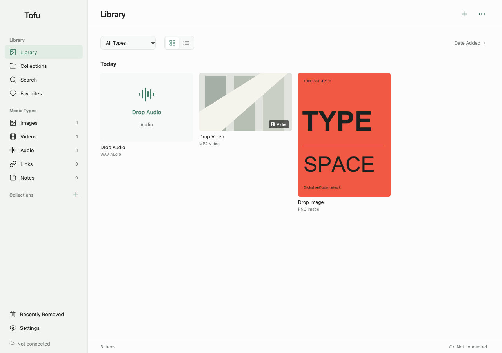

# Tofu

个人灵感素材库：收集图片、海报、视频、音频、链接和笔记，在 Mac 与 iPhone 上浏览、分类和同步。

**当前主线是可安装网页应用**，可本地运行或部署到自己的 HTTPS 域名。应用界面为英文，支持 System / Light / Dark。网页正式图标为暖灰米色底的写实白豆腐。



## 先看哪些文件

| 文件 | 用途 |
| --- | --- |
| [AGENTS.md](AGENTS.md) | 给 AI / 开发者的长期协作规则 |
| [项目背景](docs/project-context.md) | 要解决什么问题、已确认的视觉与范围 |
| [当前交接](docs/handoff.md) | 今天做到哪里、证据、下一步 |
| [架构与数据](docs/architecture.md) | 两个版本、文件职责、账号/存储/同步原理 |
| [重要决定](docs/decisions.md) | 为什么采用当前方案 |
| [踩坑记录](docs/pitfalls.md) | 症状、原因、解决办法和预防 |
| [安装与同步](docs/usage.md) | 手机与电脑如何安装、连接及验证 |
| [开发与发布](docs/development.md) | 本地运行、检查、部署边界 |
| [GitHub 准备](docs/github.md) | 待上传内容、排除规则与安全检查 |
| [图标提示词](docs/prompts.md) | 最终图标生成记录 |
| [视觉素材说明](docs/design.md) | 正式色彩、图标、参考图与使用限制 |

## 两个版本

| 路径 | 定位 | 数据 |
| --- | --- | --- |
| `web/` | **当前跨设备主线**，React/Vite + Supabase；Safari 安装 | IndexedDB 本地副本 + 私有云端 |
| `Sources/Tofu/` | 保留的 Swift 原生 Mac 本地版 | 独立本地库，不自动同步 |

已实现：保留原图的图片裁剪与去黑边建议、快速标题命名、多文件拖入与媒体分类、链接/笔记、标签与合集、收藏、搜索、Date Added 与 Creative Order、可恢复移除、账号登录、显式首次连接、前台自动同步、冲突保留、离线程序缓存。

当前限制：单文件 50 MiB；网页备份仅含元数据；手机关闭/后台时不保证同步；原生 iOS、分享扩展、网页媒体自动下载、去重、大文件分片上传均未实现。已有个人部署使用反馈；跨设备同步仍须在自己的部署中按验收清单检查。

## 开发

开发用 Node 22.12+（本机验证为 Node 26.1.0），Swift 本地版需要 macOS 14+ 与 Command Line Tools。

```sh
cd web
npm ci
npm run dev
```

打开终端显示的本地地址（默认 `http://127.0.0.1:5180/`）。

```sh
npm test
npm run build
```

浏览器检查、原生版命令、账号后台配置见 [开发说明](docs/development.md)。`npm ci` 仅安装依赖，不会上传个人数据或创建后台。

## 仓库边界

项目不包含个人素材、账号密码、个人后台标识、部署会话、数据库备份或依赖目录。精选截图使用生成测试素材。默认不配置后台也可以本地使用；云同步需要自行创建 Supabase 项目，填写 `web/.env.local`，见 [部署说明](docs/development.md)。

**使用许可：仅限个人、非商业用途。** 允许下载、私有部署及修改自用；禁止商业使用、收费分发、组织业务使用或向他人提供托管服务。详见 [LICENSE](LICENSE)。这是用途受限的公开源码项目，不采用 MIT。第三方依赖仍遵循各自许可证。
